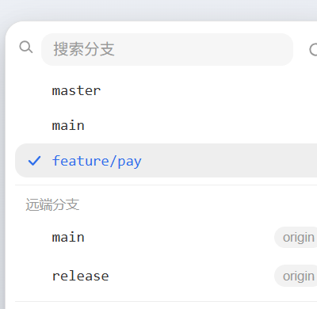

# Git Branch Switcher for DeepSeek Harness

**Keep your git workflow inside the chat.** A composer chip shows the current branch at a glance; one popup (or docked side panel) lets you switch branches, fetch remotes, commit & push, merge, stash, and inspect diffs — without leaving DeepSeek Harness.

**让 git 操作不离开 DSH 聊天窗口。**输入框工具行的胶囊实时显示当前分支，点一下就能切换/新建分支、同步远端、勾选改动提交推送、合并分支、暂存与恢复、查看 diff —— 不用切到 IDE 或终端，思路不断。面板还可停靠到右侧侧栏，腾出更大空间。

[](https://github.com/milestone-17/dsh-git-branch-switcher/releases)
[](./LICENSE)
[](https://github.com/milestone-17/dsh-git-branch-switcher/stargazers)


| 分支菜单 / Branch menu | 新建分支 / New branch | 同步远端 / Fetch | 推送改动 / Push |
|---|---|---|---|
|  |  |  |  |

> 截图来自 v0.6.1：弹层停靠在输入框上方，推送面板显示结果摘要，改动列表秒开。v0.7.0 新增侧栏模式与 diff 视图截图将在发布前补齐。

## 适合谁 / Who is this for

- 你在 DSH 里让 AI 改代码，但经常要切到 IDE 或终端看分支、切分支、提交。
- 你担心 AI 在错误分支上改代码，想一眼看清当前分支。
- 你希望推送、合并前看清楚“会发生什么”，而不是盲操作。

## 三个核心场景 / Three things it does

1. **看清分支，避免改到 main** — 输入框工具行实时显示当前分支，点一下就能切换或新建分支。
2. **聊完就推，不用切出去** — 勾选这次对话产生的改动，填一条提交信息，直接提交并推送。
3. **合并、暂存也留在聊天里** — 来源 → 目标流向一目了然；临时改动先 stash，回头再恢复。

## 为什么是它 / Why this one

- **不离开聊天**：所有操作从输入框工具行触发，DSH 就是你的心流环境。
- **不挡草稿**：v0.6.0 起所有面板都停靠在输入框上方，发送按钮和草稿始终可见可点。
- **方向明确**：推送显示「本地分支 → 上游」，合并显示「来源 → 目标」，不再点错方向。
- **秒开列表**：菜单打开时预取一次改动快照，推送/暂存/合并共享，不再干等。
- **先确认再动手**：工作区不干净、目标分支不存在、恢复暂存可能冲突时，都会先让你确认。
- **安全第一**：分支名白名单校验，文件路径按字面量传给 git，不给注入留口子；除 `git fetch`/`git push` 外不上网。
- **会话级**：每个会话按各自的工作目录独立显示分支；非 git 目录自动隐藏。

## 功能对照 / Feature map

| | 说明 |
|---|---|
| 当前分支胶囊 | 输入框工具行左侧；游离 HEAD 显示「游离 HEAD」；非 git 目录自动隐藏 |
| TRAE 风格菜单 | 顶部搜索框、本地/远端分组、当前分支勾选高亮、远端名胶囊标签、圆角阶梯 + 柔和阴影 + 入场动效 |
| 切换本地分支 | `git switch`，按最近提交排序，最多 500 条 |
| 切到远端分支 | 本地无同名分支时自动 `git switch --track` 建本地跟踪分支 |
| 一键同步远端 | `git fetch --all --prune`，完成后提示结果，失败时显示 git 原始错误 |
| 新建分支并切换 | 选源分支（默认 `master` → `main` → 当前分支，也可选远端跟踪分支），`git switch -c` 后会话立即切过去；拉取来源记入本地配置供合并推断 |
| 勾选提交并推送 | 「↑ 推送」：改动列表勾选子集 → 提交 → 推送；无上游时自动 `-u origin HEAD`；干净工作区一键推送已有提交；远端拒绝时不 force push |
| 分支合并 | 「⇆ 合并」：来源/目标双下拉，目标默认推断拉取来源（记录源 → 上游 → merge-base → master/main）；冲突列文件 + 放弃出口；成功后回到原分支 |
| 改动暂存与恢复 | 「≡ 暂存」：勾选子集（可含未跟踪文件）存成一条带描述的 stash；「暂存列表」：逐条查看文件清单，恢复（保留条目）或恢复并删除；工作区不干净时恢复前确认；可删单条或清空 |
| 弹层贴合输入区 | 面板 portal 到页面根节点、停靠在输入卡片上方，按「卡片上沿 − 会话头部」限高并在面板内滚动；内容变高时自动重新定位 |
| 侧栏模式 | 点击搜索栏右侧停靠按钮，面板切换为右侧固定侧栏；再次点击恢复为弹层；模式记入 `localStorage`，刷新后保持 |
| 查看变更 / Diff | 「⇄ 查看变更」：选择「全部变更」（对比 HEAD）或「最近基线」（对比最近一次快照），文件列表按新增/修改/删除/重命名分类，点击文件查看统一 diff |
| 来源→目标流向 | 推送面板显示「本地分支 → 上游」流向条（无上游时显示待定文案）；合并面板显示「来源 → 目标」流向条，两个下拉之间有朝下箭头 |
| 改动列表秒开 | 菜单打开即后台预取改动快照，推送 / 暂存 / 合并面板共用；合并面板一次取数同时拿到列表与目标推断；推送或暂存写操作后快照自动作废 |
| 安全确认 | 脏工作区切换/新建/合并/恢复暂存前确认；分支名白名单校验；pathspec 按字面量防路径注入 |

## 安装 / Install

### 方式一：Git 源安装（推荐）

```bash
dsh plugin --profile desktop add github:milestone-17/dsh-git-branch-switcher
```

等价写法：

```bash
dsh plugin --profile desktop install git+https://github.com/milestone-17/dsh-git-branch-switcher.git
```

国内网络可用镜像通道（内容与官方仓库一致）：

```bash
dsh plugin --profile desktop install git+https://ghproxy.net/https://github.com/milestone-17/dsh-git-branch-switcher.git
dsh plugin --profile desktop install git+https://gitclone.com/github.com/milestone-17/dsh-git-branch-switcher.git
```

### 方式二：预构建包（无需 git）

[Release 页面](https://github.com/milestone-17/dsh-git-branch-switcher/releases/latest) 附带预构建包：

```bash
# 始终是最新版
dsh plugin --profile desktop add https://github.com/milestone-17/dsh-git-branch-switcher/releases/latest/download/dsh-git-branch-switcher.tgz

# 或钉住当前版本
dsh plugin --profile desktop add https://github.com/milestone-17/dsh-git-branch-switcher/releases/download/v0.7.0/dsh-git-branch-switcher-0.7.0.tgz
```

### 方式三：市场索引

本仓库自带 `market-index.json`（DSH 官方格式，format-1），部署到任意静态地址后在插件页「发现」里添加该 URL，即可在市场里看到并一键安装：

```
https://ghproxy.net/https://raw.githubusercontent.com/milestone-17/dsh-git-branch-switcher/master/market-index.json
```

### 方式四：本地目录安装

```bash
dsh plugin --profile desktop install /path/to/dsh-git-branch-switcher
```

### ⚠️ 安装后需要重启 DeepSeek Harness 应用

插件图在应用启动时组装，安装/更新/卸载插件后**重启应用才会生效**（正在运行的会话不受影响，重启后从侧栏恢复即可）。

- 当前会话的工作目录必须是 git 仓库，胶囊才会显示；非 git 目录下自动隐藏。
- 第一次安装后如果还没打开 git 项目，会看到一个提示状态的「Git」胶囊，鼠标悬停即可看到说明（点一下就会消失）。

## 收录状态 / Where to find it

- 官方插件目录 [awesome-dsh-plugin/awesome-dsh-plugin](https://github.com/awesome-dsh-plugin/awesome-dsh-plugin) —— 已收录（[#12252](https://github.com/awesome-dsh-plugin/awesome-dsh-plugin/pull/12252)），v0.6.x 描述更新在 [#13431](https://github.com/awesome-dsh-plugin/awesome-dsh-plugin/pull/13431)。该目录是 [dsh-market](https://github.com/dsh-market/dsh-market) 市场插件目录的来源。
- 社区插件注册表 [zhu1090093659/dsh-community-plugins](https://github.com/zhu1090093659/dsh-community-plugins/pull/82)。
- 仓库带 `dsh-plugin` / `deepseek-harness` GitHub topic，可按主题检索。
- 能力卡：[unStone/dsh-xray](https://unstone.github.io/dsh-xray/p/milestone-17__dsh-git-branch-switcher.html)（C3：可 spawn 子进程 / 执行系统命令 —— git 类插件的正常评级）。

发布新版本时：更新 `market-index.json` 里 `versions[0].version`、`publishTimestamp`（Unix 秒）与 `source.commit`（40 位完整 commit SHA），并在 GitHub Release 附上新的 `.tgz`，推送到仓库即可。

## 工作原理 / How it works

- Host 半包（`index.js`）：`TypertRemoteService` 子类 `branchSwitcher`，十四个 direct 方法：
  - `status`：解析会话工作目录 → `rev-parse --show-toplevel`，然后并行跑 `rev-parse --abbrev-ref HEAD`、一条合并 `refs/heads`+`refs/remotes` 的 `for-each-ref`、`status --porcelain`（冷启动共 3 次 git spawn）；结果按仓库根做 3 秒 TTL 缓存，切换对话瞬间回显，任何写操作（checkout/fetch/create/push/merge/mergeAbort/stash/stashApply/stashDrop）都会失效缓存。
  - `checkout`：本地分支直接 `git switch`；只有远端跟踪分支时 `git switch --track <remote>/<branch>` 自动建本地跟踪分支；工作区不干净或目标不存在时先返回确认请求（每次都实时 `status --porcelain`，不读缓存）。
  - `fetch`：`git fetch --all --prune`，随后返回刷新后的仓库状态与截断后的 git 输出。
  - `create`：`git switch -c <新分支> <源分支>`，源分支可以是本地分支，也可以是远端跟踪分支（解析成具体的 ref）；重名或源分支不存在时分别报 `branchSwitcher/branch-exists`、`branchSwitcher/base-missing`；工作区不干净时先返回确认请求；建分支后把源分支写入 `branch.<名>.dsh-base` 本地配置（只落 `.git/config`，不随 push 上传）。
  - `changes`：`status --porcelain -z` 解析成带类型的改动行（新增/修改/删除/重命名/未跟踪）+ `rev-list --count @{u}..HEAD` 未推送提交数 + 远端列表 + 合并中状态；带 `inferTargetFor` 时按「记录源 → 上游 → merge-base → master/main」推断合并目标。
  - `snapshot`：用临时 `GIT_INDEX_FILE` 做 `read-tree HEAD` + `add --all` + `write-tree`，把当前工作树捕获为一个 git tree 对象；返回 `snapshotId`（格式 `tree:head`）与时间戳；每个会话保留最近 32 条快照。
  - `diff`：接受 `from`/`to` 两个快照 id（或 `HEAD`），跑 `git diff --name-status` 与 `git diff`，返回文件变更列表（含类型）与统一 diff patch。
  - `push`：勾选文件用 `:(literal)` pathspec 逐个 `git add` → `commit -m` → 无上游时 `push -u origin HEAD` 否则 `git push`；无远端/无可提交内容/空提交信息分别报 `branchSwitcher/no-remote`、`branchSwitcher/nothing-staged`、`branchSwitcher/empty-message`；远端拒绝时报 `branchSwitcher/push-rejected`（不 force push）。
  - `merge`：记录原分支 → `switch 目标` → `merge 来源` → 成功 `switch` 回原分支并返回模式（fast-forward/true/up-to-date）；冲突时留在目标分支返回冲突文件清单；非冲突失败自动 `merge --abort` 并恢复原分支。
  - `mergeAbort`：检测到 `MERGE_HEAD` 才执行 `git merge --abort`；无合并中状态报 `branchSwitcher/not-merging`。
  - `stash`：勾选子集 `git stash push -m <描述> [--include-untracked] -- :(literal)<路径>...`；勾选中的未跟踪文件先 `git add` 使 pathspec 生效；无改动可存时报 `branchSwitcher/nothing-stashed`。
  - `stashList`：`git stash list` 解析为条目（引用/描述/所在分支/日期），逐条 `git stash show --name-only --include-untracked` 列出涉及文件，最多 50 条。
  - `stashApply`：`git stash apply|pop <ref>`；工作区不干净时先返回确认请求；冲突时返回冲突文件清单并保持现场（可自行解决或 `checkout` 脱身）。
  - `stashDrop`：`git stash drop <ref>` 删单条；`all: true` 时 `git stash clear` 清空。
  - 所有 git 调用经 `subprocess.spawn` 无 shell 执行，stdio 全程收集、1 MiB 上限。
- Client 半包（`client.js`）：内联 `createTypertRemoteInfo` 声明全部十四个 direct 方法，`ctx.remote.$mount` 挂载后取 `remote.branchSwitcher` 命名空间调用；UI 注册到 `conversation.input.left`，样式全部使用 `--dsw-alias-*` 主题变量，跟随浅色/深色主题。胶囊按会话记忆上次状态，切回对话零等待渲染；输入行宽度不足时通过容器查询自动收成纯图标（与原生权限胶囊同一机制）。面板可切换为右侧固定侧栏，diff 面板从弹层/侧栏内打开。
- 分支名经白名单校验，拒绝以 `-` 开头、含空白/控制字符、`..`、`~ ^ :` 结尾等可注入参数或引用的名称；推送的文件路径按字面量 pathspec 传递。

## 开发 / Development

```bash
pnpm install
node tests/host-smoke.test.mjs     # Host 半包：真实 git 仓库 + 本地裸库远端，覆盖状态/切换/脏树确认/fetch/远端分支跟踪/新建分支/勾选提交推送/合并三态/冲突放弃/来源推断/暂存恢复删除/快照与 diff
node tests/client-smoke.test.mjs   # Client 半包：模块装载、slot 注册、Remote 调用桥（含 create/changes/snapshot/diff/push/merge/mergeAbort/stash 系列）
```

## 隐私 / Privacy

插件只在本地执行 git 命令；`git fetch` / `git push` 会按仓库自身的 remote 配置访问网络，其余命令均为本地只读/切换操作。插件不上传任何数据。

## License

MIT
